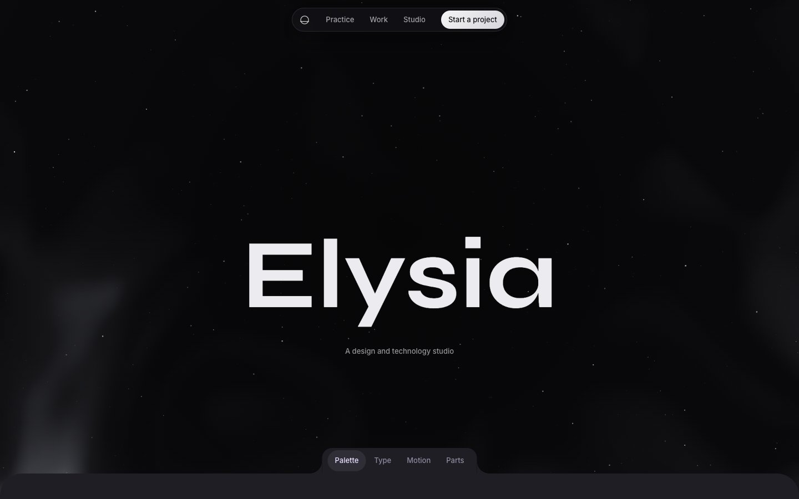
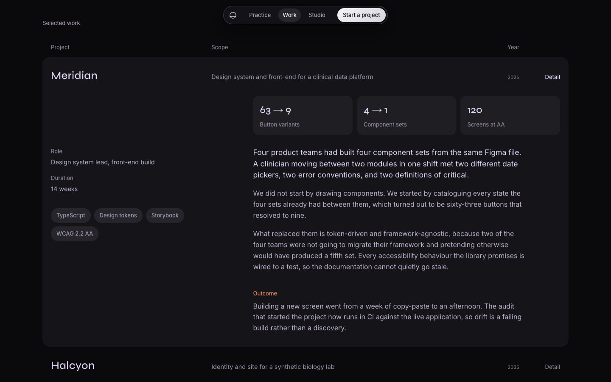
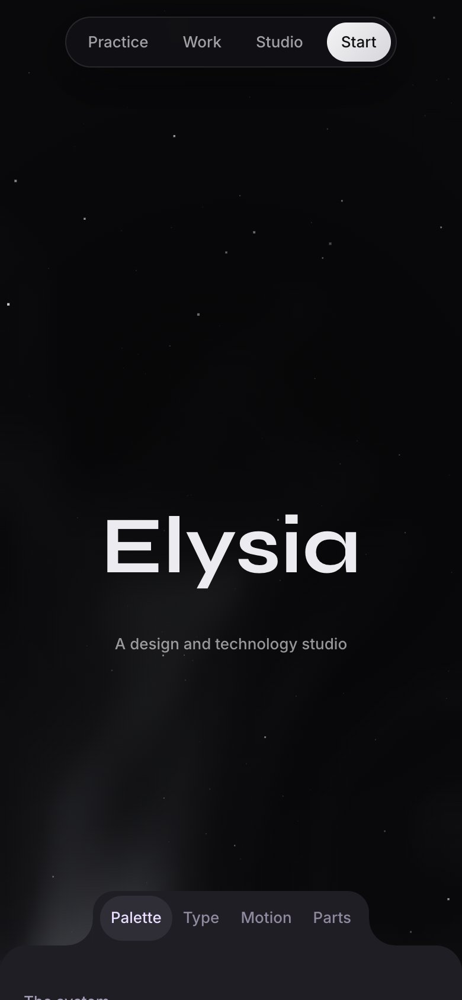
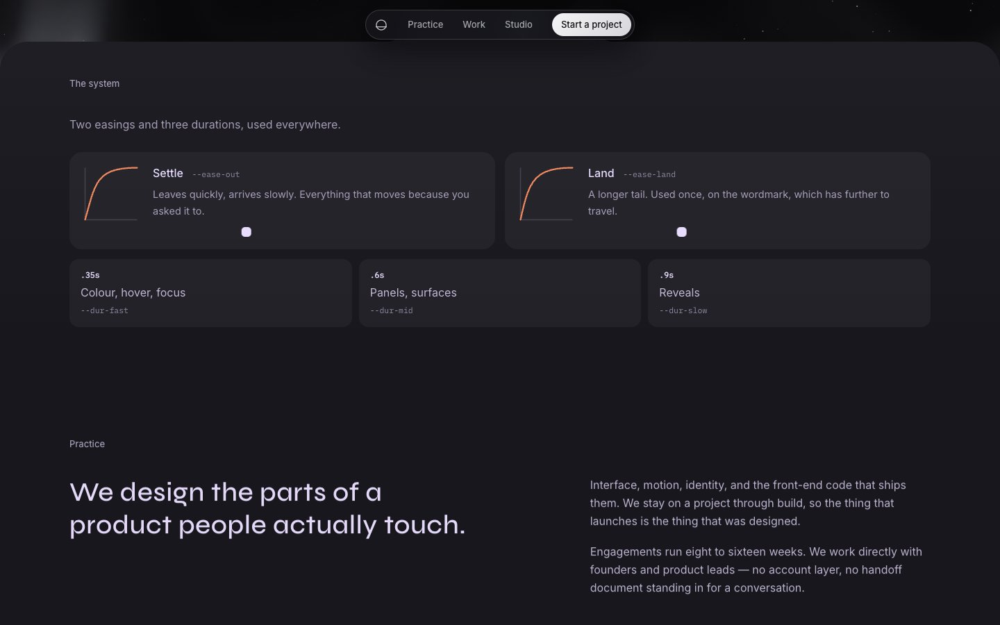

# Elysia

[](https://github.com/elysrea/elysia/actions/workflows/ci.yml)
[](https://github.com/elysrea/elysia/actions/workflows/deploy.yml)
[](LICENSE)

A studio website built as a front-end engineering project. No framework and no
runtime dependencies: content is typed data rendered to static HTML at build
time, and the hero is a live canvas nebula that keeps itself inside a frame
budget.

**[Live site](https://elysrea.github.io/elysia/)** · **[Decision log](docs/decisions.md)** · **[Run it locally](#running-it)**



> **Elysia is not a real studio.** The copy and the case studies are invented so
> that a realistic content model had something to model. The engineering is the
> point of the repository.

## At a glance

|                                                         |                                                                                                          |
| ------------------------------------------------------- | -------------------------------------------------------------------------------------------------------- |
| **Lighthouse** — median of three runs, mobile / desktop | Performance **99 / 99** · Accessibility **100 / 100** · Best practices **100 / 100** · SEO **100 / 100** |
| **Core Web Vitals** — mobile, simulated                 | LCP 1.7 s · Total blocking time 0 ms · CLS 0                                                             |
| **JavaScript**                                          | 11.2 kB, 4.6 kB gzipped — the whole site, with zero runtime dependencies                                 |
| **First visit**                                         | 8 requests, 114 KiB transferred, 96 KiB of it self-hosted fonts                                          |
| **Tests**                                               | 127 · 92.9% of statements and 94.9% of lines covered                                                     |
| **Stack**                                               | TypeScript 6 (strict) · Vite 8 · Vitest 5 · ESLint 10 · Prettier · GitHub Actions and Pages              |

## What is interesting here

### Content is data, rendered at build time

Every word on the page lives in `src/content/site.ts` as typed data. A small
Vite plugin renders it into `index.html` during the build, so the page that
ships is complete markup: it reads with JavaScript off, and crawlers get real
text. A placeholder the renderer does not know, or one left unfilled, fails the
build instead of shipping a page with a hole in it.

Prose that carries links is modelled as an array in which a string is escaped
text and an object is a link. The content cannot inject HTML, and a sentence
still reads as a sentence in the source.

### A canvas nebula with no shader, library or texture

Domain-warped fractal noise over a seeded value-noise field, sampled on a coarse
grid, pushed through a 256-entry colour ramp baked once at startup and drawn
with one `putImageData`. About two hundred lines of pure functions.

- **Deterministic.** A seeded PRNG means the same load produces the same sky, so
  tests assert exact values instead of statistical hand-waving.
- **Frame-rate independent.** Time is consumed in fixed 16.67 ms steps: the
  drift is the same on a 60 Hz laptop and a 144 Hz monitor, and a tab restored
  after ten minutes does not replay ten minutes of simulation.
- **Self-governing.** A quality governor watches the median frame time and
  scales the sample density between 100% and 35%.
- **Polite.** It pauses when scrolled away or when the tab is hidden, caps the
  device pixel ratio at 2, and under reduced motion paints a still frame of the
  same scene — watching the setting live.
- **No layout reads while animating.** The canvas size is measured on resize and
  cached. A test fails if a frame ever reads layout.

Everything about hosting an effect lives in `SceneHost`; a scene implements only
`layout`, `step` and `draw`.

### A design system that documents itself

The deck under the hero is a working specimen of the site's own tokens —
palette, type, motion and parts — inside an accessible tab group with roving
focus and arrow, Home and End keys. Values are read from the live cascade rather
than copied into the docs, so changing a token changes its documentation. The
parts tab shows the real components, not pictures of them.

### The platform first

Case studies are native `<details name="work">` elements: exclusive accordion
behaviour, keyboard support and screen-reader semantics come from the browser,
animated with `interpolate-size`. An open case study writes its own URL
fragment, so it can be linked to directly. The header is a floating capsule with
a scrollspy built on `IntersectionObserver`.

### Type as a system

Three display systems are switchable with `?type=grotesk`, `serif` or `mono`,
applied by an inline script before first paint so the page never reflows into a
different face. Each carries its own weight, tracking and leading. Nothing is set
in capitals. Browsers only download the faces a page actually uses: a default
visit fetches three of the four.

## Screens

<table>
  <tr>
    <td width="62%"></td>
    <td width="38%" rowspan="2"></td>
  </tr>
  <tr>
    <td></td>
  </tr>
</table>

## Accessibility

- Lighthouse accessibility **100** on mobile and desktop.
- Every text colour clears 4.5:1 against every background it can land on —
  computed for each ground, the lightest being a hovered card, rather than
  checked by eye.
- Complete and readable with JavaScript off. The reveal animations only hide
  content that a script is present to reveal.
- `prefers-reduced-motion` is honoured and watched live;
  `prefers-contrast: more` raises ink opacity; `prefers-reduced-transparency`
  turns the glass header solid.
- A skip link, visible focus, `scroll-padding-top` so the fixed header never
  covers a link target, and `aria-current` on the section in view.
- On narrow screens the call to action shortens to "Start" on screen while
  keeping its full name for assistive technology.

## Performance

Measured with Lighthouse 13 against the production build served locally. Every
figure is the median of three runs — a single run is not a measurement: the same
unchanged build scored 70 on its first, cold run and 95 to 99 on every run after.

|                          | Mobile | Desktop |
| ------------------------ | ------ | ------- |
| Performance              | 99     | 99      |
| First contentful paint   | 1.4 s  | 0.3 s   |
| Largest contentful paint | 1.7 s  | 0.4 s   |
| Total blocking time      | 0 ms   | 0 ms    |
| Cumulative layout shift  | 0      | 0       |

The build is one 11.2 kB script and one 19.8 kB stylesheet. Fonts are
self-hosted latin subsets, and the wordmark's face is preloaded.

One thing is known and not yet fixed: in about one run in three, the canvas
host's first size measurement at startup forces a synchronous layout. It is a
single read of layout the browser has to compute before first paint anyway. The
decision log explains why it was left, and what removing it would take.

## Tests

`npm test` runs 127 tests in Node with happy-dom — no browser required. Coverage
is 92.9% of statements, 82.8% of branches, 92.0% of functions and 94.9% of lines.

They concentrate on the places where being wrong is invisible:

- the PRNG is reproducible; the noise stays in range, is continuous, and
  differs by seed;
- the timestep planner cannot spiral after a long stall; the governor ignores a
  single long frame but reacts to a sustained run;
- the canvas host sizes itself for the pixel ratio, stops when scrolled away,
  paints a still frame instead of looping under reduced motion, releases every
  observer on destroy, and never reads layout while animating;
- the tab group handles arrow keys, Home and End with roving focus, and an open
  case study is a URL;
- the build plugin fails on an unknown placeholder, cannot be tricked by one
  named `constructor`, and renders the real `index.html` end to end.

DOM behaviour is tested against controllable stand-ins rather than a real
browser: an `IntersectionObserver` the test drives by hand, a manually advanced
animation-frame clock, and a recording 2D context.

## Architecture

```
index.html              HTML shell with <!--@slot--> placeholders
plugins/
  html-content.ts       Fills the slots at build time; emits robots.txt and sitemap.xml
src/
  content/
    site.ts             All copy, as typed data
    render.ts           Pure content → HTML, build time only
    bench.ts            What the design-system specimen shows
  features/
    hero/               SceneHost — canvas, timing, quality — and the nebula scene
    nav.ts              Floating header and scrollspy
    tabs.ts             Accessible tab group
    bench.ts            Fills the specimen from the live cascade
    work.ts             Case-study deep links
    reveal.ts           Scroll-in transitions
    type/sets.ts        The three type systems
  lib/                  Render loop, quality governor, seeded PRNG, motion and DOM helpers
  styles/               Cascade layers: tokens, base, layout, components, utilities
tests/                  Vitest and happy-dom, with hand-driven observers and a frame clock
docs/decisions.md       Why things are the way they are
```

Dependencies run one way: `lib` knows nothing about the site, `features` know
nothing about each other, and `main.ts` wires them together with each
enhancement independently guarded, so an unsupported API in one feature cannot
take the rest of the page down with it.

## Running it

Requires Node 20.19 or newer.

```bash
npm install
npm run dev
```

| Command              | Does                             |
| -------------------- | -------------------------------- |
| `npm run dev`        | Development server               |
| `npm run build`      | Typecheck, then build to `dist/` |
| `npm run preview`    | Serve the production build       |
| `npm test`           | Unit tests                       |
| `npm run coverage`   | Tests with coverage              |
| `npm run check`      | Everything CI runs               |
| `npm run fonts:sync` | Re-vendor the font subsets       |

## Deployment

Every push to `main` runs CI — typecheck, lint, format check, tests with
coverage, and a build — and a separate workflow deploys to GitHub Pages. A
project page is served from a subpath, so the deploy build is given `BASE_PATH`
and `SITE_URL`, which set the asset paths and the canonical, link-preview and
sitemap addresses. The same source builds for a domain root with neither.
Dependabot proposes dependency and workflow updates monthly.

## How decisions were made

[`docs/decisions.md`](docs/decisions.md) records every choice that was not
obvious, indexed by what still stands and what was superseded. Nothing is
deleted from it: when a decision is reversed, the new entry names the one it
replaces, because how a decision was retired is part of the record.

## Deliberately not done

- **No framework.** Nothing on this page has state worth a runtime, and a
  framework would be a larger download than the entire site.
- **No client-side routing.** It is one page.
- **No light theme.** The design is a black page with one nebula in it; a light
  version would be a different design, not a token swap.
- **No analytics and no third-party requests.** Every byte comes from the
  site's own origin.

## Credits

Typeset in [Syne](https://fonts.google.com/specimen/Syne),
[Instrument Serif](https://fonts.google.com/specimen/Instrument+Serif),
[Inter](https://fonts.google.com/specimen/Inter) and
[IBM Plex Mono](https://fonts.google.com/specimen/IBM+Plex+Mono), all under the
SIL Open Font License. Code is MIT — see [LICENSE](LICENSE).
